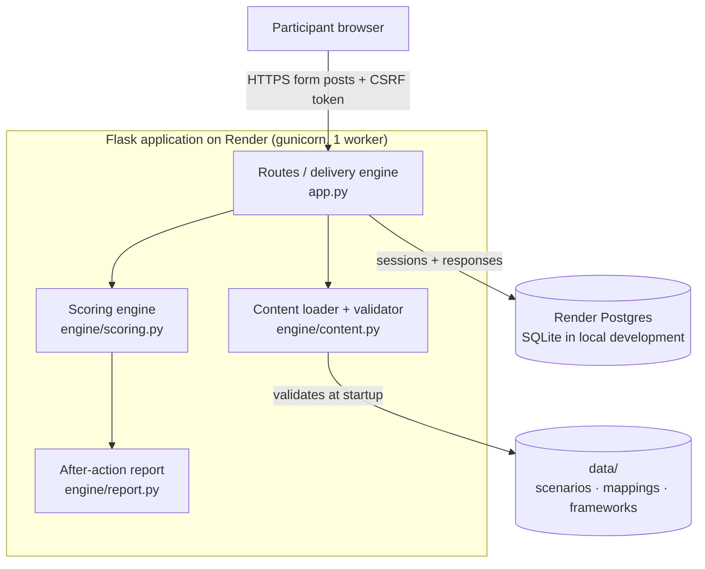

# System Architecture — AutoGSESec

Version: v0.3.0 (Hard Stop 4). Design decisions are documented in the Hard Stop 2 Design Review Package.

## Overview

AutoGSESec is a server-rendered Flask application deployed on Render with Render Postgres. Scenario content and framework mappings are versioned JSON files in Git. The database holds runtime session data only.

## Components and Status

| Component | File | Responsibility | Status at v0.3.0 |
|-----------|------|----------------|------------------|
| Delivery engine | `app.py` | Routes, session state, input validation, CSRF | Built |
| Content loader | `engine/content.py` | Loads JSON; refuses to start on missing or unknown mappings | Built |
| Scoring engine | `engine/scoring.py` | Rule-based scoring, readiness rating, gap ordering | Built; 7 known-answer cases, 64-path test |
| After-action report | `engine/report.py` | Decision review, recommended controls grouped by timeline | Built |
| Configuration | `config.py` | Database and secret key from environment; production refuses to start without either | Built |
| Persistence | `models.py` | Sessions and responses via SQLAlchemy | Built; Render Postgres |
| Pages and styles | `templates/`, `static/` | Pages, report, error page, persistent disclaimer (FR-09) | Built |
| Tests | `tests/` | 52 tests, run on SQLite and Postgres 16 on every pull request | Built |
| Evidence tools | `scripts/benchmark.py`, `scripts/collect_evidence.py` | Latency benchmark; dated evidence records | Built |
| Pre/post rating (FR-10) | — | Self-rated understanding before and after | Not started (Week 9) |
| Facilitator view, export (FR-11, FR-12) | — | Optional features | Not started |

## Scoring and Report Flow

When a participant submits decision 3, the app shows the summary, and the `/scenario/<id>/report` route:

1. Rebuilds the participant's answers from the database as `{decision_point_id: option_id}`.
2. Calls `scoring.score_session(scenario, answers)`, which returns points, percent, readiness rating, and gaps ordered Immediate, Short-term, Long-term.
3. Calls `report.build_report(scenario, score_result, control_names)`, which lists each recommended control once, at the earliest timeline any gap needs it.
4. Renders `templates/report.html`. If scoring fails, it shows `templates/error.html` instead, and the saved responses are kept.

Neither module reads files or the database. Both receive data the loader has already validated, so the same input always gives the same output (NFR-06).

## Data Design

### Content (versioned JSON in Git)

| File | Holds |
|------|-------|
| `data/scenarios/<id>.json` | Story, prompts, and options only (no framework IDs) |
| `data/mappings/<id>.json` | Rating, NIST controls, timeline, and rationale per option; ATT&CK tactic; framework versions |
| `data/frameworks.json` | Valid ATT&CK for ICS tactic IDs and NIST control IDs, with version tags |

### Runtime database

**sessions**: session_id (random UUID), scenario_id, content_version, started_at, completed_at, pre_understanding, post_understanding

**responses**: response_id, session_id, decision_point_id, option_id, submitted_at

No field identifies a person (NFR-09). Scores are not stored; the report is regenerated from responses and mappings.

## Computational Method

Deterministic, rule-based scoring. Correct = 2 points, partial = 1, incorrect = 0. Percent = earned ÷ possible × 100. Readiness: Prepared at 80% or above, Developing at 50–79%, Unprepared below 50%, compared with whole-number arithmetic so boundary scores are never misjudged by rounding. Every score traces to a named NIST control. No machine learning.

## Deployment

Render free web service, auto-deployed from `main`, start command `gunicorn app:app --workers 1`, with Render Postgres (free tier, expires about 30 days after creation). Free services spin down after about 15 minutes idle; measured wake-up time is about 32 seconds (see `docs/evidence-index.md`).
