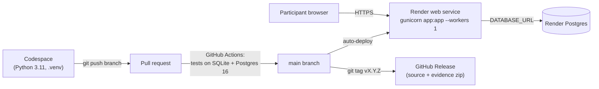

# Runbook: AutoGSESec

How to deploy, operate, and release AutoGSESec. For first-time setup and local use, see the [README](../README.md).

## Deployment pathway



## Configuration map

| Setting | Where it lives | Value |
|---|---|---|
| Code, content, evidence | GitHub repository | versioned; releases are tags |
| `SECRET_KEY` | Render → Environment | generated random value (never in Git) |
| `DATABASE_URL` | Render → Environment | Render Postgres **Internal** Database URL |
| Build command | Render → Settings | `pip install -r requirements.txt` |
| Start command | Render → Settings | `gunicorn app:app --workers 1` |
| Health check | Render → Settings | `/health` |
| Python version | `.python-version` | 3.11 (Render reads this file) |

## Deploy a change

1. Work on a branch in the Codespace; run `python -m pytest -q`.
2. Push and open a pull request; wait for both CI jobs to pass.
3. Merge. Render redeploys `main` automatically (about 2–4 minutes).
4. **Check the live site:** open `/health` and confirm `"status": "ok"`, `"database_engine": "postgresql"`, `"scenarios_loaded": 3`; then finish one exercise to the report.

## Before a demo or peer session

1. Open the live site about **one minute before** (free hosting sleeps after ~15 minutes idle; wake-up takes ~32 s).
2. Check `/health` as above.
3. If test or benchmark sessions are in the database, clear them (next section).

## Clear abandoned sessions or test data

`scripts/purge_sessions.py` is a **dry run by default**: it lists what it would delete, and deletes only with `--apply`.

```bash
# local database
python scripts/purge_sessions.py --abandoned-hours 24
python scripts/purge_sessions.py --abandoned-hours 24 --apply

# live database: use the Render Postgres EXTERNAL Database URL for this one command only
DATABASE_URL='<External Database URL from Render>' python scripts/purge_sessions.py --started-before 2026-11-18T00:00:00Z
DATABASE_URL='<External Database URL from Render>' python scripts/purge_sessions.py --started-before 2026-11-18T00:00:00Z --apply
```

Never paste the database URL into a file in the repository. Prefixing a single command, as above, keeps it out of files. (It does stay in the terminal history of that Codespace.)

## Recreate the free database (it expires about 30 days after creation)

1. Export anything worth keeping first (peer-session results go to `evidence/`, without personal data).
2. In Render: create a new free Postgres; copy its **Internal Database URL**.
3. In the web service's Environment tab, replace `DATABASE_URL`; save (Render redeploys).
4. The app creates its tables on first start. Check `/health` shows `postgresql`.

## Cut a release

```bash
python -m pytest -q
python scripts/collect_evidence.py --label vX.Y.Z
# commit evidence, update CHANGELOG.md and docs/evidence-index.md, merge
git checkout main && git pull
git tag vX.Y.Z && git push origin vX.Y.Z
```

Then on GitHub: **Releases → Draft a new release → choose the tag → Publish.** GitHub attaches a `Source code (zip)` that contains the code, the content, and the `evidence/` folder: the self-contained bundle for submissions.

## When something goes wrong

| Situation | First check | Action |
|---|---|---|
| Deploy fails, log says `SECRET_KEY` or `DATABASE_URL must be set` | Render → Environment | Set the missing variable (the startup check is working as designed) |
| Deploy fails with a content `ValueError` | The message names the file and entry | Fix the scenario or mapping, or add the control to `data/frameworks.json` |
| Site up but `/health` shows `sqlite` | `DATABASE_URL` missing | Set the Internal Database URL |
| Pages return 500 | Render → Logs | The error page keeps saved answers; fix, test, redeploy |
| Database expired | Render dashboard | Follow "Recreate the free database" |
